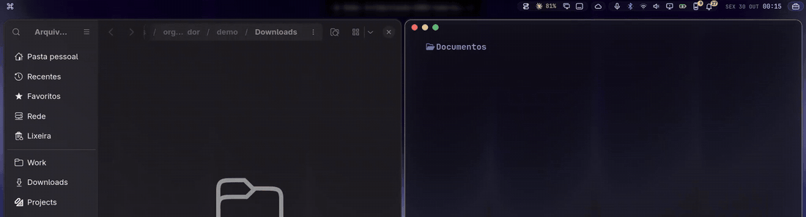

<div align="center">

# Organizador

**Your Downloads folder, filed by a local AI.**
Every document you download is read, named and put in its folder, on your own machine.



</div>

Organizador watches `~/Downloads`. When a document lands there, a local
[Ollama](https://ollama.com) model reads it and moves it to
`~/Documents/<Category>/<Year>/` under a name you can read later, such as
`2026-03-14 – NF 1234 Serviços de TI – Receita Federal.pdf`. Nothing leaves your
computer, nothing is deleted, and every move can be undone.

The defaults are Brazilian Portuguese (categories, folder names, prompt). An
English configuration is included, and every name can be changed.

## Why this one

- 🔒 **100% local.** Text extraction, OCR and the model all run on your machine.
  No cloud, no API key.
- 🏷️ **Readable names.** `date – title – issuer`, using the document's own date
  (issue, due or session date), not the download time. The year folder follows that
  date too.
- 🧾 **Reads scans and screenshots.** PDFs without a text layer and images with
  enough text go through OCR (tesseract), so a scanned invoice is filed like any other.
- ↩️ **Undo anything.** Every move goes to a log. Click *Desfazer* (Undo) on the
  notification, or run `organizador desfazer` to send the last file back.
- 🧠 **Light on memory.** One file at a time, and the model leaves (V)RAM 45 seconds
  after the last one.
- ⏳ **Leaves your fresh downloads alone.** Zips, images, videos and installers wait
  30 minutes before going to their folders by type (no AI for those), so you can
  still open what you just downloaded. Subfolders of Downloads are never touched;
  `~/Downloads/Manter` is created for files you want to keep there.
- 🔁 **Catches up.** Files left in Downloads while the service was stopped are
  handled when it starts.

## Install

```bash
git clone https://github.com/hugorolimf/organizador
cd organizador
./install.sh
ollama pull qwen3.5:4b   # once, about 3.3 GB
```

`install.sh` copies `organizador` to `~/.local/bin/`, installs the systemd user
service `organizador.service`, enables and starts it, and tells you about any
missing tool.

In English:

```bash
mkdir -p ~/.config/organizador
cp config.en.toml ~/.config/organizador/config.toml
systemctl --user restart organizador
```

## Requirements

- Linux with systemd (user services) and Python 3.11+. Made on Arch / Omarchy.
- [Ollama](https://ollama.com) running locally, with the model pulled. On Arch:
  `sudo pacman -S ollama` (or `ollama-cuda` / `ollama-rocm` for GPU) and
  `sudo systemctl enable --now ollama`.
- `inotify-tools`, `poppler` (pdftotext, pdftoppm), `tesseract` with the language
  data you use (`tesseract-data-por`, `tesseract-data-eng`), `unzip`, `libnotify`
  (notify-send).

```bash
sudo pacman -S --needed inotify-tools poppler tesseract tesseract-data-por tesseract-data-eng unzip libnotify
```

The Undo button needs a notification daemon that supports actions. Without one,
use `organizador desfazer`.

## Usage

The service runs `organizador vigiar` and you don't need to do anything else. By hand:

| Command | English alias | Does |
|---|---|---|
| `organizador vigiar` | `watch` | Watch Downloads (what the service runs) |
| `organizador arquivo <path>` | `file <path>` | File one file now |
| `organizador desfazer` | `undo` | Send the last moved file back |
| `organizador log [n]` | | Show the last *n* moves (default 10) |

`journalctl --user -u organizador -f` shows what it is doing.

### What goes where

| File | Goes to |
|---|---|
| PDF, DOCX, ODT/ODS/ODP, XLSX, PPTX, TXT, MD, CSV, RTF, XML, HTML | The category the model picks, renamed |
| Images with real text (screenshots, scans) | The category the model picks, renamed (after 30 min) |
| Other images, videos, audio, archives, installers | `Imagens`, `Vídeos`, `Áudio`, `Compactados`, `Instaladores` (after 30 min) |
| Documents it can't read (old `.doc` / `.xls`, empty text) | `Outros documentos`, original name |
| Anything else | `Outros` (after 30 min) |

Partial downloads (`.part`, `.crdownload`, …) and hidden files are ignored, and a
file is only handled once its size stops changing. If Ollama is not running, the
document stays in Downloads; run `organizador arquivo <path>` later.

## Configuration

Optional: `~/.config/organizador/config.toml` (or the path in `ORGANIZADOR_CONFIG`).
Every key is optional. `config.example.toml` lists all of them with their defaults,
and `config.en.toml` is a complete English setup. Restart the service after editing:
`systemctl --user restart organizador`.

| Key | Default | |
|---|---|---|
| `source` / `destination` | `~/Downloads` / `~/Documents` | Watched folder / where files are filed |
| `keep_folder` | `Manter` | Subfolder of `source` created on start (`""` for none) |
| `model` | `qwen3.5:4b` | Ollama model |
| `ollama_url` | `http://localhost:11434/api/chat` | Ollama chat endpoint |
| `keep_alive` | `45s` | How long the model stays loaded after the last file |
| `max_text` | `6000` | Characters of each document sent to the model |
| `wait_others_minutes` | `30` | Wait before moving non-documents |
| `ocr_languages` | `por+eng` | tesseract languages |
| `prompt` | built-in (Portuguese) | Your own prompt; `{categories}`, `{filename}` and `{text}` are filled in |
| `[categories]` | 12 Brazilian categories | `"Folder" = "what belongs there"`, read by the model. Replaces the whole list |
| `[folders]` | Portuguese names | Folders for images, videos, audio, archives, installers, unreadable documents, other files |
| `[messages]` | Portuguese | Notification texts |

The default categories lean toward Brazilian business paperwork (bids, certificates,
invoices). Replace them with your own: the folder name is what you will see, the
description is what the model reads.

If your system uses localized folders (`~/Documentos`, `~/Téléchargements`), set
`source` and `destination` (see `xdg-user-dir DOWNLOAD` and `xdg-user-dir DOCUMENTS`).

### Changing the model

The default is `qwen3.5:4b`: small enough for a laptop GPU (or the CPU), and good at
Portuguese. To use another one:

```bash
ollama pull <model>
echo 'model = "<model>"' >> ~/.config/organizador/config.toml
systemctl --user restart organizador
```

The model is asked for JSON that follows a schema (Ollama structured outputs), at
temperature 0, with an 8k context and thinking turned off (`think: false`). A
custom `prompt` must still ask for the fields `categoria` (one of the categories),
`data` (YYYY-MM-DD or empty), `emissor` (issuer) and `titulo` (short title); the
schema requires them.

## Files it writes

- `~/.local/state/organizador/movimentos.jsonl`: one line per move (when, from, to,
  category), undo moves included.
- The folders under `destination`, created as needed.

## Uninstall

```bash
./uninstall.sh
```

It stops and disables the service and removes the program and the unit. Your filed
documents stay where they are. The move log and your config are kept; remove them
with `rm -rf ~/.local/state/organizador ~/.config/organizador`.

## Em português

O Organizador vigia `~/Downloads` e, quando chega um documento, um modelo local do
Ollama lê o conteúdo e move o arquivo para `~/Documents/<Categoria>/<Ano>/` com um
nome legível (`data – título – emissor`). Tudo roda no seu computador. Nada é
apagado e todo movimento fica num log e pode ser desfeito pelo botão *Desfazer* da
notificação ou com `organizador desfazer`.

```bash
git clone https://github.com/hugorolimf/organizador
cd organizador
./install.sh
ollama pull qwen3.5:4b
```

- PDFs escaneados e prints passam por OCR (tesseract).
- Zips, imagens, vídeos e instaladores esperam 30 minutos e vão para pastas por tipo,
  sem IA.
- Subpastas de Downloads nunca são tocadas. Use `~/Downloads/Manter` para o que
  deve ficar lá.
- Categorias, pastas, modelo e textos ficam em `~/.config/organizador/config.toml`
  (veja `config.example.toml`). Depois de mudar: `systemctl --user restart organizador`.
- Comandos: `organizador arquivo <caminho>`, `organizador desfazer`,
  `organizador log [n]`.
- Para remover: `./uninstall.sh`.

## License

[MIT](LICENSE) © Hugo Rolim Filho
